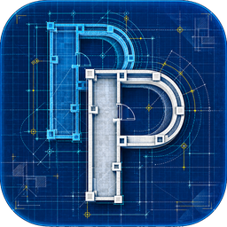

  

# PieniPlan

**Small Web Floor Plan Editor**  
**Plan simply. Draft precisely.**

PieniPlan은 브라우저에서 건축 평면을 만들고 편집하는 가벼운 2D 도면 도구입니다. **쉽게 공간을 구성하는 Plan Mode**와 **정밀하게 도면을 다루는 CAD Mode**를 하나의 프로젝트에서 사용할 수 있습니다.

처음에는 **Facility Manager에서 활용할 시설 평면을 만들기 위한 도구**로 시작했습니다. 지금도 공간의 형태를 만드는 일에 집중하고, 실제 실 이름·용도·관리 정보는 Facility Manager에서 다루는 방향을 지향합니다.

- **[PieniPlan 실행하기](https://bak2ya.github.io/PieniPlan/)**
- **[GitHub 저장소](https://github.com/Bak2ya/PieniPlan)**

> **Plan Mode는 편하고 단순하게, CAD Mode는 CAD답게.**

## 두 가지 작업 방식

### Plan Mode

시설 관리에 필요한 평면과 공간의 형태를 구성하는 작업공간입니다.

- 실제 치수를 바탕으로 벽과 공간 구성
- 문·창문·계단·기둥 등 평면 요소 표현
- 참조 도면을 바탕으로 그리기 및 위치 조정
- 건물·층·공간의 구조 정리

### CAD Mode

같은 프로젝트를 일반적인 2D CAD 방식으로 더 정밀하게 작성하고 수정하는 작업공간입니다.

- DXF 도면 열기·편집
- 선·폴리라인·원·호와 주요 2D 편집 명령
- 레이어, 스냅, 그리드, 치수·문자·주석
- 블록과 시트·PDF 출력

Plan Mode와 CAD Mode는 같은 프로젝트의 좌표 체계를 활용하며 필요에 따라 전환할 수 있습니다.

## 주요 기능

- **참조 도면:** DXF·PDF·이미지를 불러와 밑그림으로 활용
- **도면 편집:** 객체 선택, 직접 조작, Undo/Redo 및 프로젝트 저장
- **보기와 작업공간:** 층 겹쳐보기, 간결하거나 펼쳐 쓰는 도구 모음, 레이어·속성 패널
- **출력:** 도면 범위와 축척을 지정한 PDF 및 지원 형식 내보내기
- **사용 환경:** 한국어/영어, 미터법/야드파운드법, Light/Dark/Black 테마

## 프로젝트 파일

- **`.pprj` — PieniPlan Project:** CAD·Plan·참조 도면 등 전체 작업을 보관하는 프로젝트 파일
- **`.ppkg` — PieniPlan Plan Package:** Plan 정보를 공유하거나 다른 프로젝트와 연계하기 위한 패키지

## DWG 파일 사용

PieniPlan은 DXF 중심의 편집기입니다. DWG 파일은 별도 도구 **DWG2DXF**로 변환한 뒤 이어서 작업할 수 있습니다.

- **[DWG2DXF 실행하기](https://bak2ya.github.io/DWGtoDXF/)**
- **[DWG2DXF GitHub](https://github.com/Bak2ya/DWGtoDXF)**

## Facility Manager와의 관계

PieniPlan은 **건물과 공간의 형상을 작성·정리**하고, Facility Manager는 이를 바탕으로 **현재의 시설 정보와 운영 내용**을 관리하는 역할을 지향합니다. 건축 당시의 도면 정보와 현재 사용 현황을 구분하는 것이 기본 방향입니다.

## 프로젝트 방향

PieniPlan은 범용 CAD나 BIM의 모든 기능을 구현하기보다 **2D 건축 평면을 단순하고 익숙하게 다루는 경험**에 집중합니다. 작업 공간은 간결하게 유지하되, 사용자가 필요에 따라 도구와 기능을 펼쳐 활용할 수 있도록 발전시키고 있습니다.
